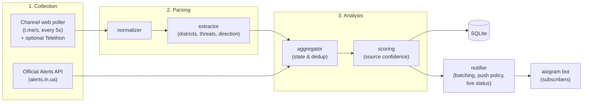

# Project PEACE — Kyiv & Kyiv Oblast Air Alert Aggregator

Real-time Telegram bot (Ukrainian UI) that monitors Telegram channels reporting air alerts,
extracts structured threat data (zone, alert level, threat type, direction),
cross-verifies sources against each other and the official alerts API, and delivers
fresh, verified updates to subscribers.

Zones: **Kyiv** is a single zone (neighbourhood names like Troieshchyna or Pozniaky map to it);
**Kyiv Oblast** is split into its 7 raions plus an oblast-wide zone.

## User Features

- 📍 **Live status** — one pinned "Статус зараз" message per chat, edited in place on every change
- 🔔 **Pushes only when it matters** — a new message is sent when the alert level changes or a new
  threat type appears; confirmations, directions and sources only update the live status
- ⚡ **Escalations at once** — a worse level or a new threat type is delivered immediately, in parallel
  at Telegram's rate limit, red first; downgrades and confirmations are merged for `BATCH_SECONDS`
- 👀 **Readable at a glance** — the first line (what a locked phone shows) is the zone and the threats
  with an icon per type (🚀 ballistic, 🔴 missiles, ✈️ aviation, 🟡 drones), the second how long it
  lasts and whether it is still unconfirmed; sources and confidence are folded away. No instructions,
  only facts
- 🔕 Unconfirmed drone alerts arrive without sound; red alerts and all-clears always ring
- 🗺 **Zone picker** — `/zones` inline keyboard, any combination of zones or "all zones"
- 🌙 **Night mode** — `/quiet`: during `QUIET_START_HOUR`–`QUIET_END_HOUR` only red escalations and all-clears push
- 🔗 Every alert links to the source posts

Admin (`ADMIN_CHAT_ID`, learn it with `/id`): a silent report every 15 minutes and a daily summary,
delivery delay (source post → push) in reports, alarms when a source fails for 10+ minutes, the disk or memory runs low or the backup is too old,
`/stats`, `/today`, `/health`, `/debug` (last unrecognised messages) and `/debug <text>` (how a text is parsed).

## Alert Level Mechanics (Kyiv / Kyiv Oblast)

- 🟡 **Yellow** — UAV threat (Shahed / reconnaissance drones)
- 🔴 **Red** — Missile threat (cruise missiles, ballistic missiles, MiG-31K / Tu-95). If both missiles and UAVs are active simultaneously, the level is 🔴 with the full list of active targets
- ⚠️ **Alert (pending details)** — Air alert declared, specific threat type not yet identified
- Threats persist until new information arrives (partial clear, e.g. "missile threat cleared, UAVs remain", or full all-clear)

## Architecture



> Collection: the Bot API **cannot read third-party channels**, so the primary collector polls the
> public web previews `https://t.me/s/<channel>` (no login needed). If an authorised Telethon userbot
> session exists, MTProto push updates are attached as well. User interaction uses a standard bot via aiogram.

## Project Structure

```
Project_PEACE/
├── config/
│   ├── channels.yaml         # Source channels and their trust weights
│   ├── regions.yaml          # Zones (Kyiv + Oblast raions) + text aliases
│   └── threats.yaml          # Threat types, alert levels, and keywords
├── .github/workflows/
│   ├── ci.yml                # Tests on every push and pull request
│   └── release.yml           # Version tag -> GitHub release with the list of changes
├── deploy/                   # Server operations, see deploy/README.md
│   ├── deploy.sh             # Pull, backup, install, test, restart, check, release tag
│   ├── backup.sh             # SQLite backup, rotation, Healthchecks.io, off-site copy
│   ├── peace-bot.service     # systemd unit of the bot
│   └── peace-backup.{service,timer}  # daily backup at 04:00
├── src/peace/
│   ├── main.py               # Entry point running all pipeline components
│   ├── login.py              # One-time interactive Telethon userbot login
│   ├── config.py             # Settings loader (.env + YAML)
│   ├── models.py             # Data models
│   ├── health.py             # Source failure tracking -> admin notices
│   ├── monitor.py            # Admin reports every 15 min, daily summary, alarms
│   ├── collector/
│   │   ├── telegram_listener.py  # t.me/s web poller (+ optional Telethon push)
│   │   └── official_api.py       # Official alerts.in.ua poller
│   ├── parser/
│   │   ├── normalizer.py     # Text normalization
│   │   └── extractor.py      # RawMessage -> ParsedEvent
│   ├── analyzer/
│   │   ├── scoring.py        # Multi-source confidence calculation
│   │   └── aggregator.py     # Stateful per-district event aggregation
│   ├── storage/db.py         # SQLite: subscribers, user settings, events, ignored messages
│   └── bot/
│       ├── handlers.py       # /start /status /zones /quiet /stop /help, admin /id /debug
│       ├── notifier.py       # Push policy, night mode, live status, safe sending
│       └── formatter.py      # User-facing message formatting (Ukrainian)
└── tests/
    ├── corpus.yaml           # Regression corpus: real messages -> expected parse
    ├── test_corpus.py
    ├── test_extractor.py
    ├── test_aggregator.py
    ├── test_official_api.py
    └── test_bot.py           # Zones, push policy, health, storage, delivery
```

## Improving the Parser

1. Send `/debug` to the bot (admin only) to see recent messages the parser ignored.
2. Check a text with `/debug <text>`.
3. Add the message to `tests/corpus.yaml` with the expected result, fix `config/threats.yaml` or
   `config/regions.yaml`, and run `pytest`.

## Local Development

```bash
python -m venv .venv && source .venv/bin/activate
pip install -r requirements.txt
cp .env.example .env                   # Fill in credentials
PYTHONPATH=src python -m peace.login   # Optional: Telethon login for faster push updates
PYTHONPATH=src python -m peace.main    # Start the bot
pytest                                 # Run tests
```

## Server

Deploy, first install, backups, monitoring and releases: [deploy/README.md](deploy/README.md).

```bash
cd /opt/Peace && deploy/deploy.sh
```
