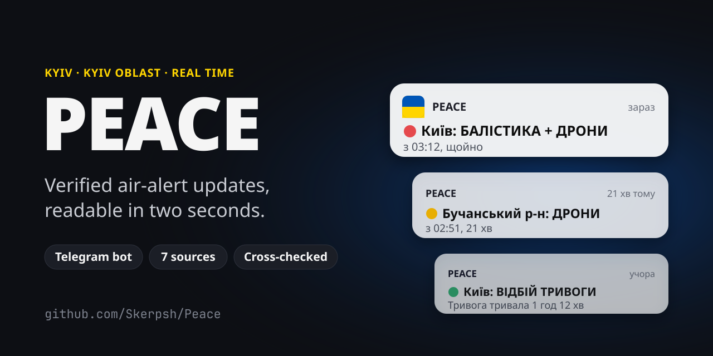
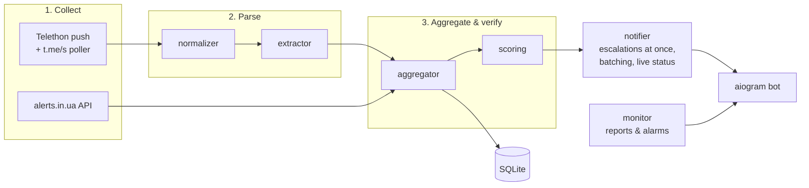

<div align="center">



[](https://github.com/Skerpsh/Peace/actions/workflows/ci.yml)
[](https://github.com/Skerpsh/Peace/releases/latest)
[](LICENSE)


[**Open the bot**](https://t.me/peacesilex_bot) ·
[How it works](#how-it-works) ·
[Run it yourself](#running-it-yourself) ·
[Self-host](#self-hosting-on-a-server)

</div>

---

PEACE is a Telegram bot that watches the channels people in Kyiv read during air alerts, together
with the official alerts API, cross-checks them, and sends one short, verified message when the
situation in your zone changes. It is built for the moment you are woken up at 3 a.m.: the first
line on the locked screen says **where** and **what**, nothing else.

> [!IMPORTANT]
> PEACE is an independent project, not an official warning system. It reports what its sources
> publish and can be late or wrong. Always follow the official air-raid sirens and the
> [Air Force of Ukraine](https://t.me/kpszsu).

## Contents

- [Features](#features)
- [What a message looks like](#what-a-message-looks-like)
- [Bot commands](#bot-commands)
- [How it works](#how-it-works)
- [Architecture](#architecture)
- [Running it yourself](#running-it-yourself)
- [Configuration](#configuration)
- [Self-hosting on a server](#self-hosting-on-a-server)
- [Improving the parser](#improving-the-parser)
- [Testing and CI](#testing-and-ci)
- [Project structure](#project-structure)
- [Contributing](#contributing)
- [Security](#security)
- [License](#license)

## Features

**Fast**
- ⚡ **Escalations at once**: a new alert, a turn to red or a new threat type skips every queue and
  goes out in parallel at Telegram's rate limit, red alerts first
- 📡 **Push collection**: channel posts arrive over MTProto (Telethon) about a second after they
  are published, with a 5-second web poller as a fallback that needs no login
- ⏱ **Measured**: the admin report shows the median and worst delay from a source post to the push

**Accurate**
- ✅ **Cross-checked**: 6 channels with trust weights plus the official alerts.in.ua API; an alert is
  confirmed when the combined confidence `1 − Π(1 − wᵢ)` reaches 0.6
- 🛡 **All-clears need more**: an alert is lowered or cleared only by an official source or by
  several channels agreeing, because a false all-clear is the most dangerous mistake
- 🎯 **Zone-aware parsing**: neighbourhoods (Troieshchyna, Pozniaky, Irpin, Boyarka, ...) map to
  their zone, other regions are ignored, partial clears ("missiles gone, drones remain") are understood

**Readable in a panic**
- 👀 **Two-line messages**: zone and threats with an icon per type, then since when and whether it
  is still unconfirmed; sources, direction and confidence are folded away
- 📍 **Live status**: one pinned "Статус зараз" message per chat, edited in place
- 🔔 **Pushes only when it matters**: a level change or a new threat type; everything else only
  updates the live status. Unconfirmed drone alerts arrive without sound; red alerts and
  all-clears always ring
- 🗺 **Your zones**: Kyiv as one zone, Kyiv Oblast by raion, any combination
- 🌙 **Night mode**: from 23:00 to 07:00 only red alerts and all-clears are sent; the live status still updates
- 🚫 **Facts, not instructions**: the bot says what is happening, not what to do

## What a message looks like

```
🚀 Київ: БАЛІСТИКА + ДРОНИ
❔ попередньо · з 03:12, щойно
▸ Напрямок · Джерела · достовірність        ← folded, opens with a tap
```

```
🟢 Київ: ВІДБІЙ ТРИВОГИ
Тривога тривала 1 год 12 хв · 04:24
```

| Icon | Meaning |
|---|---|
| 🚀 | ballistic missiles |
| 🔴 | cruise or unspecified missiles |
| ✈️ | MiG-31K / Tu-95 take-off |
| 🟡 | drones |
| ⚠️ | air alert, threat type not known yet |
| 🟢 | all clear |
| ❔ | not confirmed by other sources yet |

## Bot commands

| Command | |
|---|---|
| `/start` | subscribe to all zones and get the live status |
| `/status` | the current situation |
| `/zones` | choose zones (buttons) |
| `/quiet` | night mode on/off |
| `/stop` | unsubscribe |
| `/id` | your chat id |

Admin only (`ADMIN_CHAT_ID`): `/stats` (report now), `/today` (the day so far), `/health`
(current problems), `/debug` (recent messages the parser ignored), `/debug <text>` (how a text is parsed).

## How it works

1. **Collect.** The Bot API cannot read other people's channels, so a user account reads them
   through Telethon; without its session, the bot polls the public previews `t.me/s/<channel>`
   every 5 seconds. The official alerts.in.ua API is polled every 10 seconds.
2. **Parse.** Each post is split into clauses and matched against keyword dictionaries
   ([`config/threats.yaml`](config/threats.yaml), [`config/regions.yaml`](config/regions.yaml)):
   zones, threat types, cleared threats, all-clears, direction.
3. **Aggregate.** Per zone, a threat stays active until new information arrives: a partial clear
   or an all-clear. There is no timer; a notice appears after 30 minutes without updates.
4. **Verify.** Sources have weights ([`config/channels.yaml`](config/channels.yaml)); each source counts
   once. Raising an alert is shown at once (marked ❔ until confirmed); lowering it needs an
   official source or confirmed agreement.
5. **Deliver.** Escalations go out immediately; other changes are merged for 4 seconds so a burst
   of posts becomes one message. Then every live status is edited.

Alert levels follow Kyiv's practice: 🟡 drones, 🔴 any missile or aviation threat (with the full
list of targets when both are active), ⚠️ an alert whose type is not known yet.

## Architecture



Everything runs in one asyncio process: collectors, parser, aggregator, notifier, monitor and the
bot. State lives in memory and in SQLite (subscribers, settings, event history).

## Running it yourself

You need Python 3.12+ and a bot token from [@BotFather](https://t.me/BotFather).

```bash
git clone https://github.com/Skerpsh/Peace.git && cd Peace
python -m venv .venv && source .venv/bin/activate
pip install -r requirements.txt
cp .env.example .env                   # put BOT_TOKEN in
PYTHONPATH=src python -m peace.main    # start the bot
pytest                                 # run the tests
```

Optional, for push collection instead of polling: get `TG_API_ID` and `TG_API_HASH` at
[my.telegram.org](https://my.telegram.org), then log in once **with a phone number** (a separate
account is best: the session file gives full access to it):

```bash
PYTHONPATH=src python -m peace.login
```

## Configuration

All settings live in `.env` ([`.env.example`](.env.example)); only `BOT_TOKEN` is required.

| Variable | Default | |
|---|---|---|
| `BOT_TOKEN` | — | from @BotFather |
| `TG_API_ID`, `TG_API_HASH` | — | for the Telethon session (optional) |
| `TG_SESSION_NAME` | `data/peace_userbot` | session file, never commit it |
| `ALERTS_API_TOKEN` | — | alerts.in.ua token (optional) |
| `DB_PATH` | `data/peace.db` | SQLite database |
| `ADMIN_CHAT_ID` | `0` | who gets reports and may use admin commands |
| `MIN_CONFIDENCE` | `0.6` | combined confidence for "confirmed" |
| `STALE_AFTER_MINUTES` | `30` | show a "no updates" notice after this |
| `BATCH_SECONDS` | `4` | merge non-urgent changes within this window |
| `QUIET_START_HOUR`, `QUIET_END_HOUR` | `23`, `7` | night mode (Kyiv time) |
| `MONITOR_REPORT_MINUTES` | `15` | admin report interval |
| `MONITOR_CHECK_SECONDS` | `60` | problem check interval |
| `BACKUP_DIR`, `BACKUP_MAX_AGE_HOURS` | `/var/backups/peace`, `26` | backup age alarm |

Sources, zones and keywords are in [`config/`](config/).

## Self-hosting on a server

[`deploy/README.md`](deploy/README.md) covers the first install, deploys, releases, backups
(daily, Healthchecks.io, encrypted off-site copy) and monitoring. In short, on the server:

```bash
cd /opt/Peace && deploy/deploy.sh
```

It pulls, backs up the database, installs, runs the tests, restarts the bot, checks it stays up
and tags the next version, which becomes a [release](https://github.com/Skerpsh/Peace/releases).

## Improving the parser

Most mistakes are messages worded in a way the dictionaries do not know yet.

1. `/debug` in the admin chat lists recent messages the parser ignored.
2. `/debug <text>` shows how a text is parsed.
3. Add the message to [`tests/corpus.yaml`](tests/corpus.yaml) with the expected result, fix
   `config/threats.yaml` or `config/regions.yaml`, and run `pytest`.

A misparsed message can also be reported as an [issue](https://github.com/Skerpsh/Peace/issues/new/choose).

## Testing and CI

```bash
pytest
```

The tests cover the parser (with a corpus of real-style messages), aggregation and verification,
the official API, push policy, delivery order, message format, storage and monitoring.
[CI](.github/workflows/ci.yml) runs them on every push and pull request.

## Project structure

```
Peace/
├── config/                   # channels.yaml, regions.yaml, threats.yaml
├── deploy/                   # deploy.sh, backup.sh, systemd units, README
├── src/peace/
│   ├── main.py               # entry point: runs everything in one event loop
│   ├── login.py              # one-time Telethon login
│   ├── config.py · models.py
│   ├── collector/            # Telethon + t.me/s poller, alerts.in.ua poller
│   ├── parser/               # normalizer, extractor
│   ├── analyzer/             # aggregator, scoring
│   ├── bot/                  # handlers, notifier, formatter
│   ├── storage/db.py         # SQLite
│   ├── health.py             # source failures
│   └── monitor.py            # admin reports and alarms
├── tests/                    # pytest + corpus.yaml
└── .github/                  # CI, releases, issue templates
```

## Contributing

Ideas, misparsed messages and pull requests are welcome: see [CONTRIBUTING.md](CONTRIBUTING.md).

## Security

Please report vulnerabilities privately, see [SECURITY.md](SECURITY.md).

## License

[MIT](LICENSE) © 2026 Skerpsh
