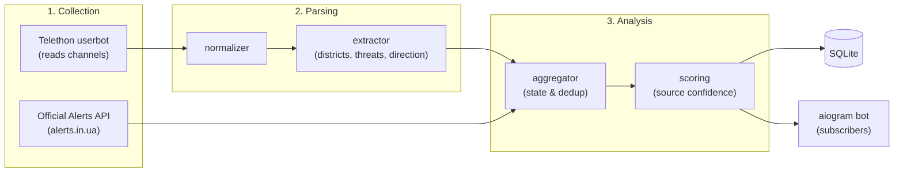

# Project PEACE — Kyiv & Kyiv Oblast Air Alert Aggregator

Real-time Telegram bot that monitors ~5 Telegram channels reporting air alerts,
extracts structured threat data (district, alert level, threat type, direction),
cross-verifies sources against each other and the official alerts API, and delivers
fresh, verified updates to subscribers.

## Alert Level Mechanics (Kyiv / Kyiv Oblast)

- 🟡 **Yellow** — UAV threat (Shahed / reconnaissance drones)
- 🔴 **Red** — Missile threat (cruise missiles, ballistic missiles, MiG-31K / Tu-95). If both missiles and UAVs are active simultaneously, the level is 🔴 with the full list of active targets
- ⚠️ **Alert (pending details)** — Air alert declared, specific threat type not yet identified
- Threats persist until new information arrives (partial clear, e.g. "missile threat cleared, UAVs remain", or full all-clear)

## Architecture



> Why two Telegram clients: standard Bot API **cannot read third-party channels**, so collection uses a user account via Telethon (MTProto), while user interaction uses a standard bot via aiogram.

## Project Structure

```
Project_PEACE/
├── config/
│   ├── channels.yaml         # Source channels and their trust weights
│   ├── regions.yaml          # Kyiv & Oblast districts + text aliases
│   └── threats.yaml          # Threat types, alert levels, and keywords
├── deploy/
│   ├── setup_vps.sh          # One-time VPS setup (systemd, venv, deploy key)
│   ├── update.sh             # VPS updater (git fetch, pytest, restart, auto-rollback)
│   └── deploy.env.example    # Optional config template for remote SSH deploy
├── deploy.sh                 # One-command deploy & service manager
├── src/peace/
│   ├── main.py               # Entry point running all pipeline components
│   ├── login.py              # One-time interactive Telethon userbot login
│   ├── config.py             # Settings loader (.env + YAML)
│   ├── models.py             # Data models
│   ├── collector/
│   │   ├── telegram_listener.py  # Telethon: new and edited channel messages
│   │   └── official_api.py       # Official alerts.in.ua poller
│   ├── parser/
│   │   ├── normalizer.py     # Text normalization
│   │   └── extractor.py      # RawMessage -> ParsedEvent
│   ├── analyzer/
│   │   ├── scoring.py        # Multi-source confidence calculation
│   │   └── aggregator.py     # Stateful per-district event aggregation
│   ├── storage/db.py         # SQLite storage for subscribers and event logs
│   └── bot/
│       ├── handlers.py       # /start /status /districts /subscribe /stop
│       └── formatter.py      # User-facing message formatting
└── tests/
    ├── test_extractor.py
    └── test_aggregator.py
```

## Local Development

```bash
python -m venv .venv && source .venv/bin/activate
pip install -r requirements.txt
cp .env.example .env                   # Fill in credentials
PYTHONPATH=src python -m peace.login   # One-time: interactive phone + code login
PYTHONPATH=src python -m peace.main    # Start the bot
```

## VPS Deployment

Run directly on the VPS inside the cloned repository (e.g. `/opt/Peace`):

```bash
./deploy.sh            # First run sets up venv, .env, and systemd; subsequent runs pull, test, and restart
nano .env              # Fill in TG_API_ID, TG_API_HASH, BOT_TOKEN
./deploy.sh login      # One-time interactive userbot login
./deploy.sh restart    # Start/restart the peace-bot systemd service
./deploy.sh logs       # Follow live logs
./deploy.sh status     # Check systemd service status
```
