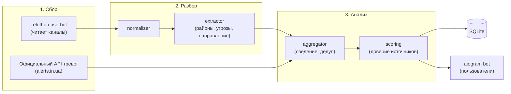

# Project PEACE — агрегатор воздушных тревог (Киев / Киевская область)

Telegram-бот, который в реальном времени читает ~5 Telegram-каналов о воздушной тревоге,
извлекает из сообщений структурированные данные (район, уровень, тип угрозы, направление),
сверяет источники между собой и с официальным API тревог, и отдаёт пользователю
только свежую и подтверждённую информацию.

## Механика уровней тревоги (Киев / область)

- 🟡 **Жёлтый** — угроза БпЛА (шахеды, разведдроны)
- 🔴 **Красный** — ракетная угроза (крылатые, баллистика, МиГ-31К / Ту-95). Если одновременно есть и ракеты, и БпЛА — уровень 🔴 + полный список целей
- ⚠️ **Тревога (уточняется)** — тревога объявлена, тип угрозы ещё не известен
- Угроза держится до новой информации (частичное снятие, например «загроза ракет минула, БпЛА лишаються», или полный отбой)

## Архитектура



> Почему два клиента: обычный Bot API **не может читать чужие каналы**, поэтому сбор идёт через
> пользовательский аккаунт (Telethon, MTProto), а общение с пользователями — через обычного бота (aiogram).

## Структура

```
Project_PEACE/
├── config/
│   ├── channels.yaml         # каналы-источники и их вес доверия
│   ├── regions.yaml          # районы Киева и области + варианты написания
│   └── threats.yaml          # типы угроз, уровни и ключевые слова
├── deploy/
│   ├── setup_vps.sh          # одноразовая настройка VPS (systemd, venv, deploy key)
│   ├── update.sh             # обновление на VPS (git fetch, тесты, рестарт, автооткат)
│   └── deploy.env.example    # шаблон настроек для ./deploy.sh
├── deploy.sh                 # деплой одной командой с локальной машины
├── src/peace/
│   ├── main.py               # точка входа, запускает все компоненты
│   ├── login.py              # одноразовый интерактивный вход userbot-аккаунта
│   ├── config.py             # настройки (.env + yaml)
│   ├── models.py             # модели данных
│   ├── collector/
│   │   ├── telegram_listener.py  # Telethon: новые/отредактированные сообщения
│   │   └── official_api.py       # опрос официального API тревог
│   ├── parser/
│   │   ├── normalizer.py     # чистка текста (регистр, укр/рус)
│   │   └── extractor.py      # текст -> ParsedEvent
│   ├── analyzer/
│   │   ├── scoring.py        # расчёт суммарного доверия источников
│   │   └── aggregator.py     # сведение событий в текущую картину по районам
│   ├── storage/db.py         # подписчики, история событий
│   └── bot/
│       ├── handlers.py       # /start /status /subscribe ...
│       └── formatter.py      # вывод для пользователя
└── tests/
    ├── test_extractor.py
    └── test_aggregator.py
```

## Локальный запуск

```bash
python -m venv .venv && source .venv/bin/activate
pip install -r requirements.txt
cp .env.example .env              # заполнить ключи
PYTHONPATH=src python -m peace.login   # один раз: вход по номеру телефона и коду
PYTHONPATH=src python -m peace.main    # запуск бота
```

## Деплой на VPS

### 1. Одноразовая настройка на VPS (Ubuntu / Debian)
```bash
bash setup_vps.sh git@github.com:Skerpsh/Peace.git main
```
Затем на VPS заполнить `.env`, один раз выполнить `PYTHONPATH=src .venv/bin/python -m peace.login` и запустить сервис `sudo systemctl start peace-bot`.

### 2. Обновление в одну команду
Локально скопируйте `cp deploy/deploy.env.example deploy/deploy.env`, укажите `VPS_HOST` и `VPS_USER`, после чего при каждом изменении:
```bash
./deploy.sh            # git push + обновление на VPS (с тестами и автооткатом)
./deploy.sh logs       # логи бота в реальном времени
./deploy.sh status     # статус systemd-сервиса
./deploy.sh restart    # перезапуск сервиса
```
